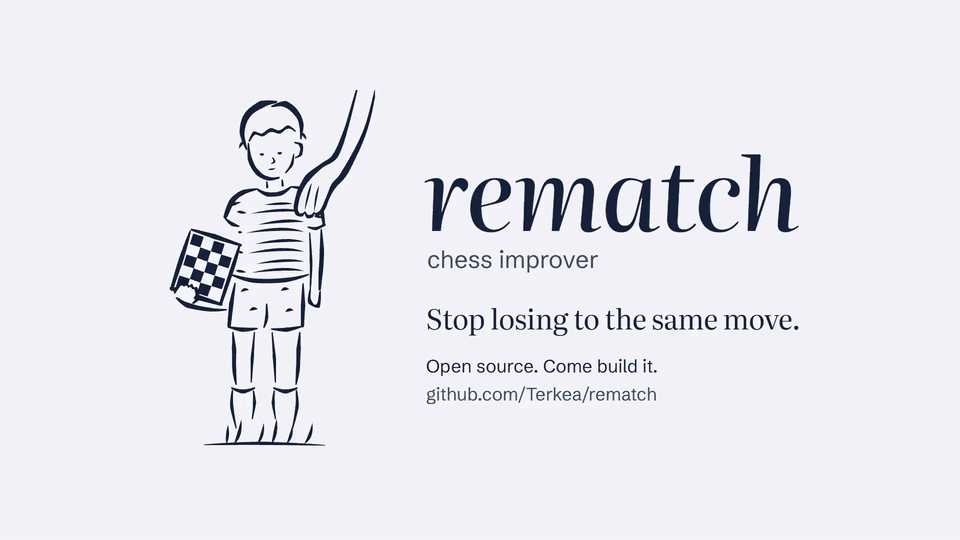
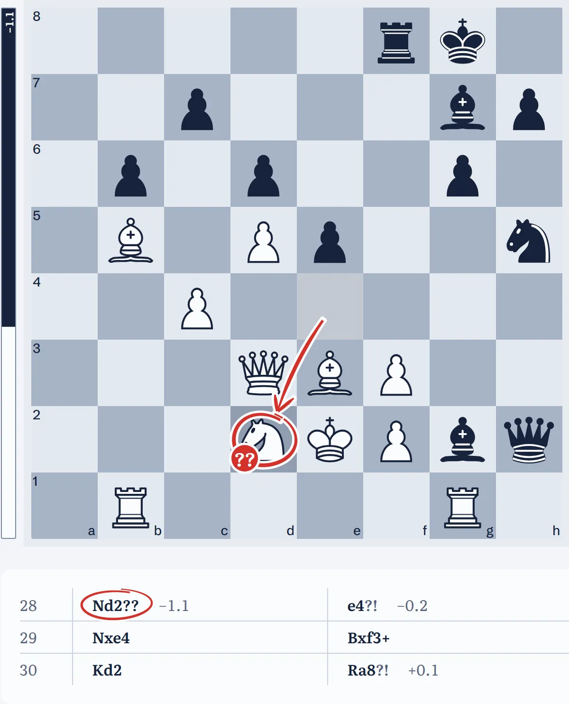
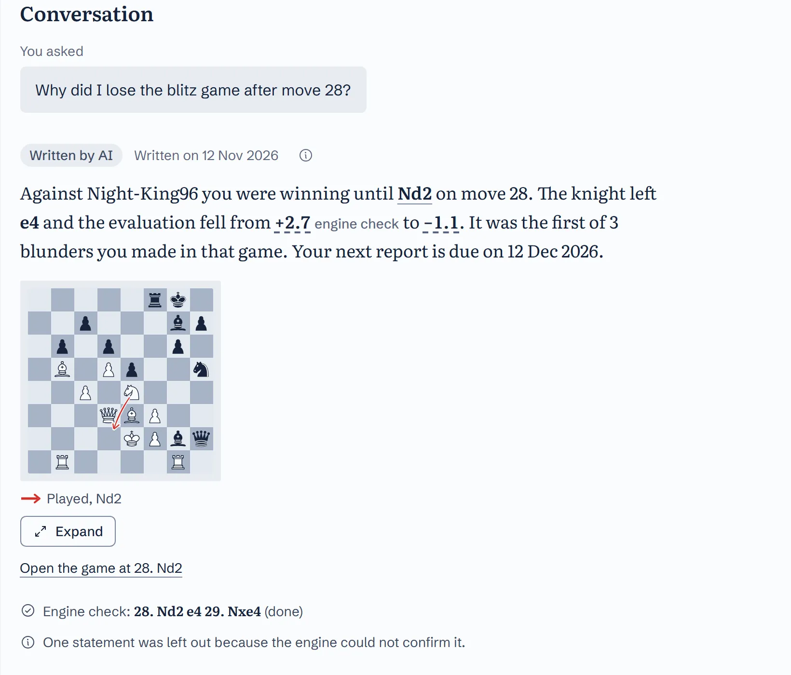
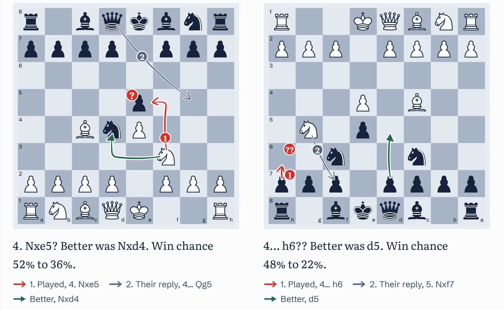
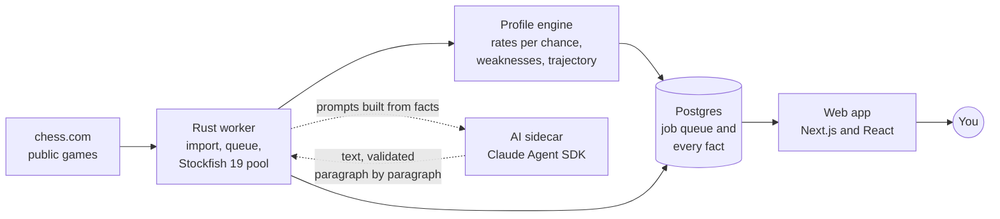

# Rematch, chess improver

**Stop losing to the same move.**

Rematch is an open-source coach for chess.com players. Stockfish checks every move of your games, Rematch names the mistakes you keep repeating, drills you on your own missed moments and tells you, with honest numbers, whether it's working.

[](https://github.com/Terkea/rematch/actions/workflows/ci.yml)
[](LICENSE)
[](docs/SDLC.md)
[](https://github.com/Terkea/rematch/discussions)
[](https://github.com/Terkea/rematch/issues?q=is%3Aissue+is%3Aopen+label%3A%22good+first+issue%22)

<a href="https://terkea.github.io/rematch/"></a>

**[▶ Watch the 60-second video](site/public/media/rematch.mp4)** (MP4, 5 MB) · [or on the website](https://terkea.github.io/rematch/) · [Read the docs](https://terkea.github.io/rematch/docs/getting-started/)

## Why

You don't lose to new mistakes. You lose to the same one again. A review shows you the blunder and the engine's better move, then the next game starts, and nobody tells you it was the same knight move, the same missed fork, the same rushed move with a minute on the clock as last week.

The research on learning says what fixes that: retrieving your own errors, spaced over days, with feedback about the move rather than about you ([the evidence](docs/research/2026-11-23-what-helps-amateurs-improve.md)). Rematch is built on it.

## What it does

The screenshots are the app's own interface on its styleguide's demo data, never a player's account.

### Every move, checked by Stockfish

Link your chess.com account and Rematch imports your games, keeps them in sync and analyses every move with Stockfish 19 under a pinned protocol. The turning points are marked like a coach's scoresheet: a red pen for your mistakes, the better move in green, and a win-chance graph showing where the game turned.

<picture><source media="(prefers-color-scheme: dark)" srcset="site/public/shots/review-dark.webp"></picture>

### Weaknesses and strengths, explained

Each mistake is counted per chance, not per game: a loose piece per move that had one, a missed fork per fork you had. Rematch ranks them by what they cost, explains each in a sentence and compares you with players around your rating. Every rate carries its count and an 80% range.

<picture><source media="(prefers-color-scheme: dark)" srcset="site/public/shots/weaknesses-dark.webp"></picture>

### An AI coach that cites your games

Ask why you lost after move 28 and the answer points at the position, the move and the evaluation. Claude writes the words; Stockfish and the app's statistics supply every fact. A validator checks each paragraph against your data before you see it, and what can't be checked is left out, with a note saying so. The AI is optional: without a key, every number is still there.

<picture><source media="(prefers-color-scheme: dark)" srcset="site/public/shots/coach-dark.webp"></picture>

### A trainer built from your missed moments

Positions where you missed a mate, a win or a tactic, or blundered, come back as drills. Play your move, say whether you were sure, see the verdict with the engine's line on the board. Right answers return after 1, 3, 7, 21 and 60 days; a miss comes back tomorrow. One position in five is held back, so "Is it working?" can compare drilled patterns with the rest.

<picture><source media="(prefers-color-scheme: dark)" srcset="site/public/shots/positions-dark.webp"></picture>

### One focus a week, with a number to hit

Rematch suggests the weakness that costs you most and sets a target over your next 10 to 40 games. Under 10 chances it says "Too early to tell", and it compares you with the goal, never claiming you improved.

<picture><source media="(prefers-color-scheme: dark)" srcset="site/public/shots/focus-dark.webp"></picture>

### What changed since your peak

Your rating line with the peak marked, then the games around the peak against your last games: rating, accuracy, blunders per game, score and your top weaknesses, each called better or worse only when the evidence separates.

<picture><source media="(prefers-color-scheme: dark)" srcset="site/public/shots/trajectory-dark.webp"></picture>

## Why it's different

- **Research first.** Features are ranked by what the evidence says helps amateurs improve: retrieval practice on your own errors, spacing, interleaving, specific goals with feedback. The notes are in [`docs/research/`](docs/research/).
- **Honest numbers.** A count with every rate, an 80% range with every estimate, no number below 10 games ("Need 9 more games"), and "better" or "worse" only when the ranges separate. [The honesty rules](https://terkea.github.io/rematch/docs/honesty/).
- **Facts by reference.** The AI never types a move or a number. It cites computed facts by reference, the server renders them, and a validator drops any claim it can't check.
- **Private by default.** Run it yourself and your games stay in your database. It reads only public chess.com data, and its requests never carry your email address.
- **Every decision written down.** [More than 140 decision records](docs/decisions/README.md) explain why the code is the way it is.

## How it works



A Rust worker imports your games, analyses them with a pool of Stockfish 19 engines and builds your profile; Postgres holds the job queue and every computed fact; the Next.js app draws it all with one design system. The optional AI sidecar runs Claude through the Agent SDK, and Rust validates everything it writes. More in [the architecture](https://terkea.github.io/rematch/docs/architecture/).

## Quick start

You need Docker with about 16 GB of memory and Git.

```sh
git clone https://github.com/Terkea/rematch.git && cd rematch
cp .env.example .env          # then add your address: INVITE_ALLOWLIST=you@example.com
sh scripts/rust-cache-init.sh # once per Docker host: the shared Rust build caches
docker compose up -d --build  # Postgres, Redis, the Rust worker with Stockfish, the web app, Mailpit
docker compose ps             # wait for web to be healthy
```

Open <http://localhost:3100>, ask for a sign-in link and open it from Mailpit at <http://localhost:48025>. Then link your chess.com username. [Getting started](https://terkea.github.io/rematch/docs/getting-started/) covers verification, the AI coach and the optional pieces; [CONTRIBUTING.md](CONTRIBUTING.md) covers development and tests.

## Roadmap

**Shipped:** Stockfish analysis of every move, explained weaknesses and strengths, the citing coach, the missed-moments trainer, the weekly focus, the rating trajectory, and a coach that knows your plan.

**Next:** a daily rhythm (a forgiving streak and an opt-in daily email), "Is it working?" sooner, the opening-trap line trainer, conversion play-outs against an engine at your opponent's level, and a time-use drill.

**Open for contributors:** Lichess import behind a flag, translations, mobile polish, PGN upload, a smaller Docker profile and more end-to-end tests. [The full roadmap](https://terkea.github.io/rematch/docs/roadmap/).

Rematch is a beta: every release is `v0.y.z`, and 1.0 is reserved for the first complete release ([how we ship](docs/SDLC.md)).

## Help build Rematch

It gets better with people who play, people who coach and people who build.

- **Rust developers:** the worker, the analysis pipeline, the profile engine and the coach's validator.
- **TypeScript and React developers:** the Next.js app and its design system.
- **Chess coaches and strong players:** what should a 1200 practise, and how would a good coach say it? Open a [coaching idea](https://github.com/Terkea/rematch/issues/new?template=coaching_idea.yml).
- **Designers:** the annotated-scoresheet system in [`packages/ui/DESIGN.md`](packages/ui/DESIGN.md).
- **Testers:** run it on your own games and tell us where it's wrong.

Start with a [good first issue](https://github.com/Terkea/rematch/issues?q=is%3Aissue+is%3Aopen+label%3A%22good+first+issue%22), say hello in [Discussions](https://github.com/Terkea/rematch/discussions), and read [CONTRIBUTING.md](CONTRIBUTING.md). AI-assisted pull requests are welcome: [CLAUDE.md](CLAUDE.md) and [`.claude/skills`](.claude/skills) are the house rules. Everyone follows the [code of conduct](CODE_OF_CONDUCT.md); security reports go through [SECURITY.md](SECURITY.md).

## Licence and acknowledgements

Rematch is licensed under the [GNU AGPL-3.0](LICENSE). If you run a modified version as a network service, offer its users the source.

It stands on the work of others, each under its own licence ([NOTICE](NOTICE)): [Stockfish](https://stockfishchess.org/) (GPL-3.0), the [Lichess open database](https://database.lichess.org/) (CC0) for peer references and the opening explorer, the Syzygy endgame tablebases, [Maia-2](https://github.com/CSSLab/maia2) (MIT, optional), the Cburnett pieces (BSD-3-Clause), [chess.js](https://github.com/jhlywa/chess.js) and [react-chessboard](https://github.com/Clariity/react-chessboard), [Phosphor icons](https://phosphoricons.com/), and the Literata and Schibsted Grotesk typefaces (SIL OFL 1.1). The AI coach is written by Anthropic's Claude.

Rematch is not affiliated with chess.com or Lichess.
