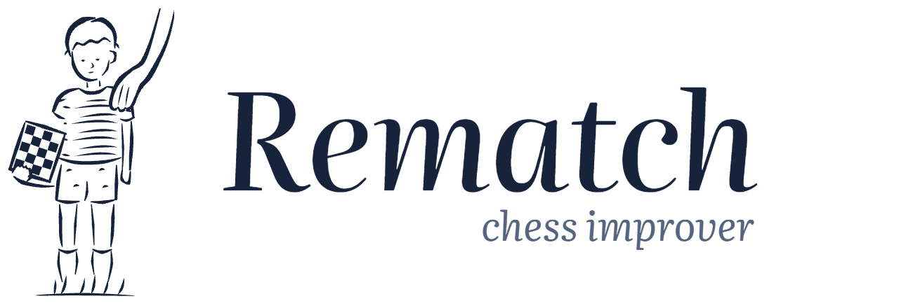
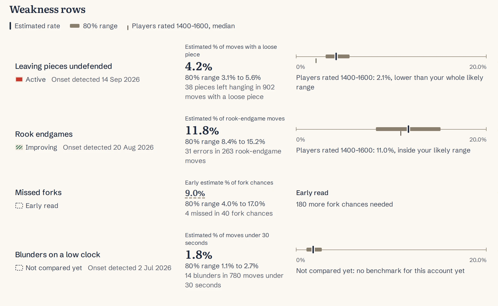
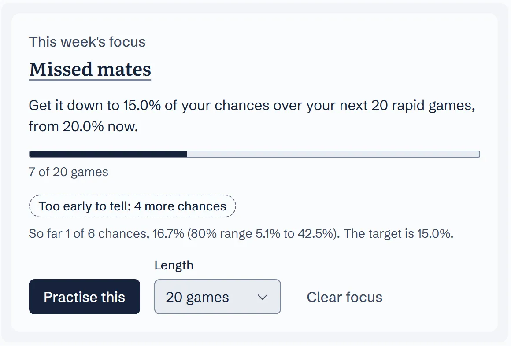
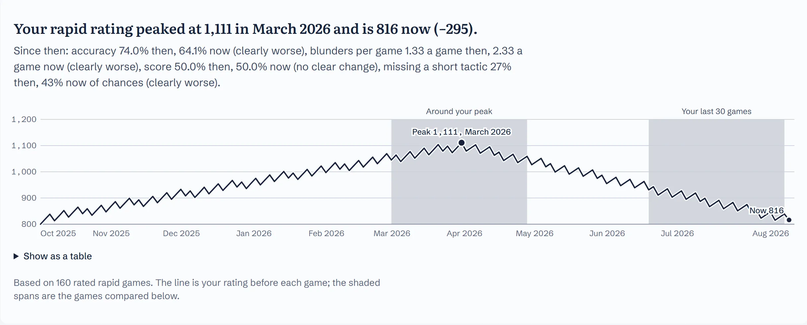
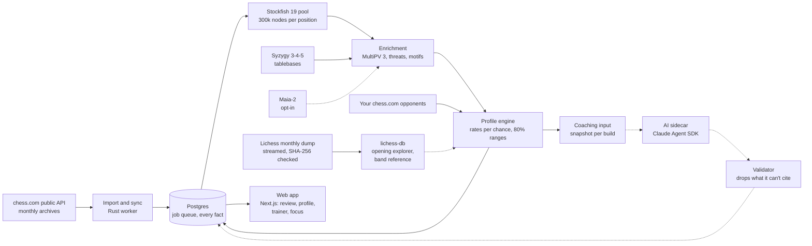

<picture><source media="(prefers-color-scheme: dark)" srcset="docs/media/rematch-lockup-night.png"></picture>

# Rematch, chess improver

## Chess, taught the way you learn.

A patient coach that learns your patterns, re-evaluates them after every game and points you at the one thing that will take you higher. The engine, the statistics and the AI are just how it works out what to teach you next.

Stop losing to the same move. Rematch is free and open source, for chess.com players, and it tells you with honest numbers whether it's working.

For anyone who knows how the pieces move, up to about 2000. Above 2000 it hasn't been tested with real players yet; if you're 2000+, [tell us where it's wrong](https://github.com/Terkea/rematch/issues/new?template=coaching_idea.yml).

[](https://github.com/Terkea/rematch/actions/workflows/ci.yml)
[](LICENSE)
[](docs/SDLC.md)
[](https://github.com/Terkea/rematch/discussions)
[](https://github.com/Terkea/rematch/issues?q=is%3Aissue+is%3Aopen+label%3A%22good+first+issue%22)

<a href="https://terkea.github.io/rematch/"></a>

[Watch the 60-second video](site/public/media/rematch.mp4) (MP4, 5 MB) · [on the website](https://terkea.github.io/rematch/) · [the docs](https://terkea.github.io/rematch/docs/getting-started/)

## Why

You don't lose to new mistakes. You lose to the same one again. A review shows you the blunder and the engine's better move, then the next game starts, and nobody tells you it was the same knight move, the same missed fork, the same rushed move with a minute on the clock as last week.

The research on learning says what fixes that: retrieving your own errors, spaced over days, with feedback about the move rather than about you ([the evidence](docs/research/2026-11-23-what-helps-amateurs-improve.md)). Rematch is built on it.

## What it does

The screenshots are the app's own interface on its styleguide's demo data, never a player's account.

### Every move, checked by Stockfish

Link your chess.com account and Rematch imports your games, keeps them in sync and analyses every move with Stockfish 19 under a pinned protocol. The turning points are marked like a coach's scoresheet: a red pen for your mistakes, the better move in green, and a win-chance graph showing where the game turned.

<picture><source media="(prefers-color-scheme: dark)" srcset="site/public/shots/review-dark.webp"></picture>

### Weaknesses and strengths, explained

Each mistake is counted per chance, not per game: a loose piece per move that had one, a missed fork per fork you had. Rematch ranks them by what they cost, explains each in a sentence and compares you with players around your rating. Every rate carries its count and an 80% range.

<picture><source media="(prefers-color-scheme: dark)" srcset="site/public/shots/weaknesses-dark.webp"></picture>

### An AI coach that cites your games

Ask why you lost after move 28 and the answer points at the position, the move and the evaluation. Claude writes the words; Stockfish and the app's statistics supply every fact. A validator checks each paragraph against your data before you see it, and what can't be checked is left out, with a note saying so. The AI is optional: without a key, every number is still there.

<picture><source media="(prefers-color-scheme: dark)" srcset="site/public/shots/coach-dark.webp"></picture>

### A trainer built from your missed moments

Positions where you missed a mate, a win or a tactic, or blundered, come back as drills. Play your move, say whether you were sure, see the verdict with the engine's line on the board. Right answers return after 1, 3, 7, 21 and 60 days; a miss comes back tomorrow. One position in five is held back, so "Is it working?" can compare drilled patterns with the rest.

<picture><source media="(prefers-color-scheme: dark)" srcset="site/public/shots/positions-dark.webp"></picture>

### One focus a week, with a number to hit

Rematch suggests the weakness that costs you most and sets a target over your next 10 to 40 games. Under 10 chances it says "Too early to tell", and it compares you with the goal, never claiming you improved.

<picture><source media="(prefers-color-scheme: dark)" srcset="site/public/shots/focus-dark.webp"></picture>

### What changed since your peak

Your rating line with the peak marked, then the games around the peak against your last games: rating, accuracy, blunders per game, score and your top weaknesses, each called better or worse only when the evidence separates.

<picture><source media="(prefers-color-scheme: dark)" srcset="site/public/shots/trajectory-dark.webp"></picture>

## What it does that a game review doesn't

- Research first: features are ranked by what the evidence says helps amateurs improve (retrieval practice on your own errors, spacing, interleaving, specific goals with feedback). The notes are in [`docs/research/`](docs/research/).
- Honest numbers: a count with every rate, an 80% range with every estimate, no number until the minimum evidence is there ("Need 9 more games"; [the thresholds](#when-rematch-stays-quiet)), and "better" or "worse" only when the ranges separate. [The honesty rules](https://terkea.github.io/rematch/docs/honesty/).
- Facts by reference: the AI never types a move or a number. It cites computed facts by reference, the server renders them, and a validator drops any claim it can't check.
- Private by default: run it yourself and your games stay in your database. It reads only public chess.com data, and its requests never carry your email address.
- Every decision written down: [more than 140 decision records](docs/decisions/README.md) explain why the code is the way it is.

## How it works

<!-- how-it-works:start -->

A game becomes advice like this: Rematch imports it from chess.com, Stockfish 19 checks every move, the critical moves get a closer look, the profile counts what you keep getting wrong per chance, and the trainer brings your own missed moments back as drills. The coach is optional, and it only puts computed facts into words.



Dotted lines are optional. Without Maia, the Lichess reference builds or an AI key, everything on a solid line still runs.

A Rust worker imports your chess.com games and analyses every position with Stockfish 19 under a fixed protocol, so the same position always gets the same number. An enrichment pass adds the engine's top three lines on the critical moves, a threat probe, tactical motifs, tablebase verdicts in five-piece endings and, if you run it, Maia-2's estimate of how many players at your rating would have found the move. The profile engine turns that into counts of chances and mistakes per weakness, smooths them with a Bayesian prior and gives every rate an 80% range. Postgres holds the job queue and every computed fact. The web app reads them directly and builds the trainer and the weekly focus from your own positions. Claude is optional: it writes the words of reports and chat answers, but only through reference tokens that the server resolves, and a validator drops any paragraph that states a fact it can't trace back to the computed data.

### One blunder, from import to drill

The styleguide's sample game is a real Lichess blitz game, so here is what the pipeline does to its 28th move, White's 28. Nd2??

1. Before the move Stockfish gives White +271 centipawns. That is a win chance of 73.06%. After Nd2 it is −111, or 39.92%.
2. The drop is ΔW = 33.14 points. Anything from 15 up is a blunder, so the move is marked `??` and the review draws a red ring on d2.
3. The move's accuracy is 22.2 on the 0 to 100 scale, and it pulls the game accuracy down through the harmonic mean, which punishes one bad move more than an average would.
4. ΔW ≥ 15 makes it a "decisive" move, and the win chance before it was within 40 points of 50, so it was an "eligible" chance for the per-move weaknesses. If the engine's refutation wins at least two pawns within three plies, it is one event of W1, "Leaving pieces hanging", in that game's counts.
5. Because it is judged a blunder and the engine's best move differs from the one played, it becomes a trainer item, unless a hash of the game and ply puts it in the 20% held back to measure whether drilling works.

<details>
<summary>Import: chess.com only, public data, kept in sync</summary>

Rematch reads your public chess.com games from the monthly archives, newest first, and checks every linked account for new games every 30 minutes.

- Source: The public Published-Data API at `https://api.chess.com/pub/player`. The importer reads `/games/archives`, then walks the monthly archives newest first and normalises each game ([`chesscom.rs`](backend/crates/platforms/src/chesscom.rs)). Time classes come from `base + 40 × increment`: under 180 s is bullet, under 480 s blitz, under 1500 s rapid, else classical ([`time_control.rs`](backend/crates/chess-core/src/time_control.rs)). Daily games keep chess.com's own class.
- Rate limits: Each platform has one serial HTTP client: one request at a time. A 429 waits 60 s and retries up to 3 times, and a circuit breaker opens after 5 consecutive outages (5xx, timeouts, transport errors; never a 404 or a 429) for 60 s ([`client.rs`](backend/crates/platforms/src/client.rs), [`breaker.rs`](backend/crates/platforms/src/breaker.rs)). The User-Agent is the fixed string `rematch/0.1 (+https://github.com/Terkea/rematch)`. No request carries an email address ([ADR 0043](docs/decisions/0043-no-email-in-outbound-requests.md)).
- Sync: A recurring `sync-accounts` job runs every 5 minutes, a sixth of the 30-minute interval, and enqueues an incremental import for the accounts that are due, the longest-waiting first. The linked accounts are spread over the interval, so chess.com never gets them in one burst ([ADR 0076](docs/decisions/0076-recurring-account-sync.md), [`sync.rs`](backend/crates/analysis/src/jobs/sync.rs)).
- Ownership: Anyone may link a public username and see its engine analysis. The AI report and the coach need a verified link: you put a short code anywhere in your chess.com profile's location field, and the server reads it back ([ADR-WEB-5](docs/decisions/ADR-WEB-5-chesscom-verification.md), [ADR-FIX-N-1](docs/decisions/ADR-FIX-N-1-unverified-links-see-analysis-only.md)).
- Lichess: The Lichess importer and OAuth are in the tree and tested, but `LICHESS_ENABLED` defaults to off. We chose to get one platform right first ([ADR 0040](docs/decisions/0040-chesscom-first-defer-lichess-accounts.md)). The open Lichess game database is a different thing: it is reference data, described below.

</details>

<details>
<summary>Engine analysis: Stockfish 19, win chance, accuracy, judgements</summary>

Stockfish 19 searches every position at a fixed 300,000 nodes, so the same position always gets the same number, and a drop of 15 win-chance points is a blunder, as on Lichess.

#### The engine

The engine is **Stockfish 19**, the official `stockfish-linux-x86-64-universal` build, downloaded in the Docker build and checked against a pinned SHA-256 ([`backend/Dockerfile`](backend/Dockerfile)). At start the worker reads the engine's banner and refuses anything that isn't Stockfish 19. The pool runs `min(cores − 2, 8)` engines (at least 1; `WORKER_POOL_SIZE` overrides it), starts two at a time because each cold start loads the NNUE net, replaces a crashed engine and retries its search once ([`pool.rs`](backend/crates/engine/src/pool.rs), [`start.rs`](backend/crates/worker/src/start.rs)).

#### The protocol

The protocol is `sf19-n300k-v1`: 300,000 nodes per position, MultiPV 1, `Threads 1` and `Hash 16` sent explicitly to every engine (Stockfish 19's defaults, so sending them changed no evaluation; `ENGINE_THREADS` and `ENGINE_HASH_MB`), a 30 s timeout ([`types.rs`](backend/crates/engine/src/types.rs)). We fix nodes rather than time or depth, because a node count gives the same answer on a slow laptop and a fast server. Evals are stored once per position and protocol in `position_evals`, keyed by the position, and shared by every user, so a common position is never searched twice. A protocol change means re-analysis ([ADR 0007](docs/decisions/0007-analysis-protocol-pinned.md)).

#### The algorithm version

Every constant, protocol, prompt set and model above is named in one generated file, [`algorithm/manifest.json`](algorithm/manifest.json), and the whole has one id, for example `algo-1.0.0+fd96e117c013`: a version for people and the first 12 hex characters of the manifest's sha256 as the proof ([ADR 0105](docs/decisions/0105-algorithm-manifest-stamping-and-replay.md)). Every row a recommendation comes from (the coaching input, the report run, the estimates, the focus, the drill items) stores the id it was computed with, and the report, the focus card and the trainer link it to [`algorithm/CHANGELOG.md`](algorithm/CHANGELOG.md). `cli algo show` prints it and `cli algo diff A B` names what changed between two. A replay suite runs the fixture games through the whole pipeline twice and compares the bytes with committed goldens, so a change that moves a fact cannot merge without a major version bump.

#### Win chance

We use the Lichess formulas, not chess.com's unpublished ones ([ADR 0008](docs/decisions/0008-lichess-win-percent-classification.md), [`score.rs`](backend/crates/chess-core/src/score.rs)):

```text
cp = the mover's centipawns, clamped to ±1000
chances = 2 / (1 + exp(−0.00368208 · cp)) − 1
W = 50 + 50 · chances
ΔW = max(0, W_before − W_after)
```

Any mate counts as ±1000. `chances` runs from −1 to 1, `W` is the win chance from 0 to 100, and ΔW is measured from the mover's side. So +100 is about 59%, and +300 about 75%.

#### Judgements

A drop in `chances` of at least 0.3 is a blunder, 0.2 a mistake and 0.1 an inaccuracy ([`judgement.rs`](backend/crates/chess-core/src/judgement.rs)). On the 0 to 100 scale that is ΔW ≥ 15, 10 and 5. Mates get their own rule, as on Lichess: walking into a forced mate is a blunder unless you were already lost by more than 700 cp (mistake) or 999 cp (inaccuracy), and letting a forced mate of your own slip is judged by how good the position still is afterwards, with the same 700 and 999 cut-offs.

#### Accuracy per move

Per-move accuracy is Lichess's curve:

```text
accuracy = 103.1668100711649 · exp(−0.04354415386753951 · ΔW)
 − 3.166924740191411 + 1
```

It is clamped to [0, 100], and a move that lost nothing scores 100.

#### Accuracy per game

Game accuracy is a port of lila's `AccuracyPercent.gameAccuracy` ([ADR-FIX-C-1](docs/decisions/ADR-FIX-C-1-lila-accuracy-and-pre-game-ratings.md), [`game_accuracy.rs`](backend/crates/chess-core/src/game_accuracy.rs)). It averages two means of the per-move accuracies:

- a volatility-weighted mean: each move is weighted by the standard deviation of White's win chance over a sliding window of `clamp(moves / 10, 2, 8)` positions, clamped to [0.5, 12], so moves in sharp positions count more;
- a harmonic mean, with each move floored at 1, so a single 0 can't zero the game.

The result is `(weighted + harmonic) / 2`. Opening, middlegame and endgame accuracy use the same formula on each phase's slice of the game. The opening lasts at least 20 and at most 30 plies ([`phase.rs`](backend/crates/chess-core/src/phase.rs)). The expected score uses pre-game ratings. chess.com doesn't publish them, so the player's pre-game rating is the rating after their previous rated game in the same time class.

#### Scheduling

New games go first, in tiers, and previews of the first 20 games run at priority 0, ahead of everything else, so a new account sees its first analysis before the backfill ([ADR-R2-16](docs/decisions/ADR-R2-16-tiered-analysis-scheduler.md), [ADR-R2-15](docs/decisions/ADR-R2-15-fair-scheduling-and-preview.md)).

</details>

<details>
<summary>Enrichment: the critical moves get a closer look</summary>

Up to 30 critical moves a game get the engine's top three lines, a threat probe and motif tags.

The main eval gives one line per position. Weakness detection needs more: was there a second good move, was there a threat, what was the tactic. Enrichment adds that without ever touching the main evals, under its own protocol ids ([ADR-R2-14](docs/decisions/ADR-R2-14-enrichment-protocol.md), [`protocol.rs`](backend/crates/enrich/src/protocol.rs)):

- Critical plies: A move is critical when it lost ΔW ≥ 5, or when the previous move lost ΔW ≥ 10 (the reply to a big mistake). At most 30 per game, the biggest drops first ([`critical.rs`](backend/crates/enrich/src/critical.rs)).
- MultiPV 3 at 300k nodes on those plies (`sf19-n300k-mpv3-v1`). It fills the best line and the refutation line, and gives the gap between the first and second line (`multipv_gap`) and whether the move played was in the top two. It never replaces the MultiPV-1 eval: a three-line search spreads its effort and can disagree with the one-line search, and ΔW must stay comparable across games and players.
- Threat probe: 50,000 nodes on the position with the side to move passed (a null move), skipped when in check (`sf19-n50k-null-v1`). If the opponent would have a winning shot, there was a threat, and the move either dealt with it or didn't.
- Motifs: A clean-room tagger reads each engine line and tags it: hanging piece, fork, pin, skewer, discovered attack, deflection, sacrifice, promotion, mate in 1, 2, 3 or 4+, mating net, back-rank mate, smothered mate ([ADR-R2-3](docs/decisions/ADR-R2-3-motif-tagger-clean-room.md), [`motifs/`](backend/crates/profile-core/src/motifs/)). A line counts as a tactic when it wins at least 2 pawns of material or mates. Every tag is computed and stored, but only the ones EXP-0007 showed to be right at least 4 times in 5 against Lichess's puzzle themes are named to you: fork, discovered attack, promotion, smothered mate and mate in 1, 2, 3 or 4+. Mating net has no Lichess theme to be scored against and stays named. Hanging piece, pin, skewer, deflection, sacrifice and back-rank mate stay hidden until a fix or a human audit clears them; a move they tagged still counts as a missed tactic or a blunder, with its eval swing and the best move ([`motifs.rs`](backend/crates/coaching-input/src/motifs.rs), [ADR 0112](docs/decisions/0112-hide-the-motifs-exp-0007-did-not-clear.md)).

The cost is about 25–40% more CPU than the main analysis. A known bias, stated in the ADR: a hard position you handled well, with no swing before it, is never probed, so rates built on `is_critical` are only compared with references built the same way.

</details>

<details>
<summary>Syzygy tablebases: perfect verdicts with five pieces or fewer</summary>

In an ending with five pieces or fewer, the Syzygy tables give the exact result, so a move that throws it away is counted for certain.

- The tables: The 3-4-5 piece WDL and DTZ sets from `tablebase.lichess.ovh`, 290 files. `lichess-db syzygy` streams each to a `.part` file while hashing it, and renames it only when the SHA-256 matches the pinned manifest [`syzygy-345.sha256`](backend/crates/lichess-db/data/syzygy-345.sha256). The files are never committed ([ADR-R2-22](docs/decisions/ADR-R2-22-syzygy-345-fetch.md)).
- The probe: A separate Stockfish, never one from the analysis pool, with `SyzygyPath` set, searching 1,000 nodes. Keeping it separate means the 300k evals are identical with or without the tables (a test checks the main pool never sets `SyzygyPath`). Stockfish reports a tablebase win as `cp 20000 − plies`, so `cp ≥ 19000` or a positive mate is a win, `cp ≤ −19000` or a negative mate a loss, anything else a draw ([`wdl.rs`](backend/crates/enrich/src/tablebase/wdl.rs), [ADR-R2-12](docs/decisions/ADR-R2-12-local-syzygy-probe.md)).
- When: Every requested move whose position has at most 5 pieces, kings included, and no castling rights. The answer is cached per position in `position_tb`. The clocks are reset before probing, so a win that needs more than 100 plies to the next capture or pawn move counts as a draw, as the 50-move rule would make it.
- What it feeds: W8: a move that turns a tablebase win into a draw or loss, or a draw into a loss, is an event. W8.basics covers KPvK, KQvK, KRvK, KRvKP, KRPvKR, KQvKP and KPvKP; W8.advanced every other five-piece ending ([`endgame.rs`](backend/crates/profile-core/src/weakness/endgame.rs)).
- Without tables the probe answers nothing, the worker logs one warning, and W8 has no chances. Nothing is guessed. A DTZ probe exists for drills, but nothing reads it yet.

</details>

<details>
<summary>Maia-2: would a player at your rating have found it?</summary>

If you run it, Maia-2 estimates how many players at your rating would have found the move, which tells a hard miss from an easy one.

Stockfish says what the best move was. It can't say whether a 1200 would ever see it. [Maia-2](https://github.com/CSSLab/maia2) is a neural network trained on human games that predicts which moves a player of a given rating plays ([ADR-R2-13](docs/decisions/ADR-R2-13-maia-licence-and-difficulty.md), [`difficulty/`](backend/crates/enrich/src/difficulty/)).

- It's opt-in: It runs as a separate Python service (`services/maia`, FastAPI, the `rapid` or `blitz` checkpoint, CPU torch) that you add with `docker-compose.maia.yml`.
- Input: The position before the move, the mover's rating and the opponent's rating (`eloSelf`, `eloOppo`), in batches of at most 32. The service clamps ratings to [1000, 2100], Maia-2's buckets.
- Output: A probability for every legal move. We keep two numbers: `p_best`, the probability the engine's best move is played, and `p_ok`, the probability of any move within 5 win-chance points of the best line.
- Where it's used: W11, "Mistakes on easy moves": a chance is a move where `p_ok ≥ 0.8` (most players at your level would find a good move) and the event is a blunder there. On the strengths page, "Your best moves in hard spots" prefers positions where you found the best move and `p_best ≤ 0.3`, the hardest first.
- Not before ply 10: Maia-2 wasn't trained on the first ten half-moves, so those positions are never sent.
- Without Maia nothing is estimated in its place. There is no engine-spread fallback: difficulty comes from Maia or not at all (ADR-R2-13), and a test fails if any other difficulty provider appears in the code. The positions are stored as `pending_maia`, W11 has no chances, the hard-spots board falls back to critical, balanced positions (a best line at least 15 points ahead of the second, win chance 25–75%), and the pages say how many positions are still waiting. When Maia comes back, a sweep fills them in; a position that keeps failing is retried at most 3 times.

</details>

<details>
<summary>The weaknesses: W1 to W12, each with a definition of a chance</summary>

Every weakness is a count: events out of chances. "Missed forks" means forks you missed out of forks you had, never forks per game. Three words come up throughout ([`detectors.rs`](backend/crates/profile-core/src/weakness/detectors.rs), [ADR-R2-4](docs/decisions/ADR-R2-4-weakness-metric-rulings.md)):

- eligible: the win chance before the move is within 40 points of 50, so the game wasn't already decided;
- decisive: the move lost ΔW ≥ 15, a blunder;
- tactic: an engine line that wins at least 2 pawns or mates.

| Key | Name in the app | A chance is | An event is |
|---|---|---|---|
| W1 | Leaving pieces hanging | an eligible move | decisive, and the refutation wins ≥ 2 pawns within 3 plies, without mate |
| W2 | Missing your opponent's threat | an eligible move facing a threat | decisive, and the threat not addressed |
| W3.shallow / W3.deep | Missing a short / longer tactic | an eligible move whose best line is a tactic realised within 3 plies / at 4 or more | ΔW ≥ 15 and the move played not among the top two |
| W4.missed | Missing a mate | a move with a mate in 1 to 4 on the board | the mate is gone after the move |
| W4.allowed | Allowing a mate | an eligible move, not already being mated | being mated after the move |
| W5 | Not winning won games | a winning episode: 3 own moves in a row at W ≥ 85, from ply 21 | the game wasn't won |
| W6 | Defending lost positions | a losing episode: 3 own moves in a row at W ≤ 15 | the game was lost |
| W7.traps | Early blunders | a game with an own move by ply 20 | a decisive move by ply 20 |
| W7.prep | Leaving the opening worse | the end of the opening | W ≤ 40 there |
| W8.basics / W8.advanced | Basic / harder endgames | a move in a ≤ 5-piece position with both tablebase verdicts | the verdict got worse |
| W9a | Getting short of time | a clocked, non-daily game | the clock fell under 10% of the base before move 40, or with 10+ own moves left |
| W9b | Blunders on a low clock | an eligible move with under 30 s, in bullet, blitz or rapid | decisive |
| W9c | Rushing important moves | an eligible critical move with a time reading | a mistake or blunder played in under half your median time |
| W9d | How you spend your time | Spearman ρ of time spent against the MultiPV gap, over ≥ 10 moves | continuous, never ranked |
| W10 | Drifting in quiet positions | an eligible quiet middlegame move: not critical, no tactic in the best line, \|cp\| ≤ 150 | ΔW ≥ 5 |
| W11 | Mistakes on easy moves | an eligible move with Maia `p_ok ≥ 0.8` | decisive |
| W12 | Tilt and tiredness | games 4+ in a session (games under 15 minutes apart), or right after a loss | continuous: actual minus expected score, never ranked |

Some rules that keep the counts honest:

- Unknown is not "no": A move whose event can't be decided, for example a blunder with no refutation line, isn't a chance at all. Counting it as a non-event would push the rate towards zero.
- W3 and W10 need every best line: If any eligible move in a game lacks its best line, the game reports no W3 and no W10. Otherwise the moves that have a line would be selected by their outcome, because enrichment fills lines mainly on critical moves.
- Cost is counted once: One move can match several keys (a hung piece under 30 s is W1, W9b and maybe W11). Its expected points lost go to the first key in W4 > W2 > W1 > W3 > W8 > W7 > W10, so those keys' costs can be added up. The others overlap and never are.
- Motif rows: `motif.missed:fork` counts the W3 chances whose best line was a fork; `motif.allowed:fork` the W1 chances where your blunder allowed one. Only the named motifs above get rows.
- Conversion and time trouble are also per-game metrics: entering an endgame at W ≥ 70 is a conversion chance, at W ≤ 30 a hold chance; time trouble is W9a's rule; a "missed punishment" is your reply to an opponent's mistake or blunder that lost ΔW ≥ 10 ([`game_metrics.rs`](backend/crates/profile-core/src/weakness/game_metrics.rs)).

</details>

<details>
<summary>Rates and uncertainty: the prior, the 80% range, the seeded bootstrap</summary>

Each rate is a Beta posterior with an 80% range, pulled towards your peers' rate until your own games outweigh it.

#### A rate per chance is a Beta posterior

The posterior comes from [`posterior.rs`](backend/crates/profile-core/src/stats/posterior.rs) ([ADR-R2-5](docs/decisions/ADR-R2-5-posterior-priority-conventions.md)):

```text
weight = 0.5^(age_days / 60)
posterior = Beta(n0 · μ + k, n0 · (1 − μ) + n − k)
range = the 10% and 90% quantiles of the posterior
```

Games older than 183 days are left out. Here k and n are the weighted events and chances, μ is the peer rate (a flat Beta(1, 1) prior when there are no peers, and for W5, whose comparison is the evaluation's prediction rather than a population of players), and n0 is the prior strength in chances: W1 300, W2 100, W3 60, W4 40, W5 and W6 30, W7 40, W8 80, W9a 30, W9b 40, W9c 60, W10 600, W11 300. The range is an equal-tailed 80% interval.

The prior pulls a thin record towards what players like you do. Ten chances can't move a W10 rate far from the peer rate (n0 = 600); a few hundred can. Every interval in the product is 80%, because 95% ranges on 30 games are so wide they say nothing.

- Confidence is P(your true rate > the peer rate). A weakness is "Costing you games" only when its timeline state is active, emerging or relapsed, that confidence is at least 0.7 and it is ranked (priority above 0); otherwise it goes to "Worth watching" ([ADR 0084](docs/decisions/0084-costing-state-and-peer-comparison-agree.md), [ADR 0101](docs/decisions/0101-weakness-ranking-floor-and-baselines.md)). With no event in the window, confidence is 0: we never claim certainty about something that never happened.
- Priority = excess × trainability × confidence, where the excess is the expected points lost per game above the peers' rate and trainability is a per-band table ([`constants.rs`](backend/crates/profile-core/src/constants.rs)). Fewer than 30 games, no peers or no event means priority 0, so nothing is ranked on thin evidence.
- The ranking floor: A weakness ranks only when its 80% range lies entirely above the peer rate and its excess is at least 0.02 points per game, one game's result in 50 (`RANK_MIN_EXCESS_PER_GAME` in [`priority.rs`](backend/crates/profile-core/src/stats/priority.rs), [ADR 0101](docs/decisions/0101-weakness-ranking-floor-and-baselines.md)). Below it the rate, its range and its confidence are still shown, but its priority is 0: not enough evidence yet. A clean record can rank nothing, and then the overview, the report and the coach say that nothing stands out. On the first benchmark run the clean control's blunders on a low clock (11 in 846 chances against a peer rate of 0.008, range 0.0075 to 0.018) ranked first; the floor stops that.
- W5 is compared with the evaluation: Your opponents' conversions in games against you are your own saves seen from the other side, so W5 has no peer rate. A winning episode starts at W ≥ 85, and the win chance is the expected score, so the evaluation expects such a position to lose 0.15 of a point. W5's benchmark is the failure rate that loses exactly that, 0.15 divided by your own points lost per failure (half a point for a draw, one for a loss), and its excess is the points per game you lose from winning positions beyond that prediction. The prediction is not a prior, so W5's rate keeps the flat Beta(1, 1) (`model_baseline` in [`priority.rs`](backend/crates/profile-core/src/stats/priority.rs)). It applies to the all-games estimate only; the colour pages compare each colour with its own peers. The win-chance curve was fitted to strong players' results, so this is a stricter standard for a club player than a peer rate would be. We don't know yet how many club players it flags; Tier 2 of the benchmark will measure it.
- The timeline: A Bayesian online change-point detector (hazard 1/200) and a CUSUM find when a rate shifted, which gives the states (emerging, active, improving, resolved, relapsed) ([ADR-R2-6](docs/decisions/ADR-R2-6-timeline-detector-and-states.md)).
- Means (accuracy, blunders per game) get a percentile bootstrap: 1,000 resamples with seed 1 in the Rust KPI snapshots, 2,000 in the web's filtered stats. Counts like the score use a Wilson interval.
- Stable ranges: The web's bootstrap used to index rows in database order and put ids in its seed, so the same games could give a slightly different range on another load. It now sorts the values and seeds mulberry32 from an FNV-1a hash of the metric name and the sorted values ([`bootstrap.ts`](apps/web/src/server/stats/bootstrap.ts)). Same games, same range, every time.

</details>

### When Rematch stays quiet

Rematch prints no number until it has the evidence, and says how much more it needs. Each minimum counts a different thing:

| What | Needs, and where it is set |
|---|---|
| Accuracy, blunders per game, score on any page | 10 games: `KPI_MIN_GAMES` in [`stats/constants.ts`](apps/web/src/server/stats/constants.ts) |
| Each colour's numbers, for you and for the coach | 10 games with that colour: `MIN_COLOR_GAMES` in [`limits.rs`](backend/crates/coaching-input/src/limits.rs) |
| A weakness ranked at all | 30 games in the 6-month window, a peer rate (or for W5 the evaluation's prediction) and one event: `MIN_GAMES` in [`priority.rs`](backend/crates/profile-core/src/stats/priority.rs) |
| A weakness ranked rather than "not enough evidence yet" | its 80% range entirely above the peer rate, and at least 0.02 points per game above it: `RANK_MIN_EXCESS_PER_GAME` in [`priority.rs`](backend/crates/profile-core/src/stats/priority.rs), [ADR 0101](docs/decisions/0101-weakness-ranking-floor-and-baselines.md) |
| A weakness rate called sufficient | its key's chances: W5 and W6 15, W9a 20, W3, W4, W7 and W9b 40, W8 50, W9c 60, W1, W2 and W11 1,000, W10 1,500: `min_evidence` in [`constants.rs`](backend/crates/profile-core/src/constants.rs) |
| A peer rate shown | 10 distinct opponents, and at least the chances your own rate needs: `LOW_SAMPLE_PLAYERS` in [`reference_aggregate.rs`](backend/crates/profile/src/reference_aggregate.rs), [ADR 0081 Amendment 1](docs/decisions/0081-peer-benchmark-pooled-rate.md) |
| An area score | each component's own minimum; otherwise "need N more" for the first short one: `need_more` in [`area_scores.rs`](backend/crates/profile-core/src/kpi/area_scores.rs) |
| A period comparison | 10 games on each side: `compareRates`, `compareMeans` in [`compare.ts`](apps/web/src/server/stats/compare.ts) |
| The rating trajectory | 20 rated games (two windows of 10): [ADR 0089](docs/decisions/0089-rating-trajectory-and-then-vs-now.md) |
| A focus verdict | 10 chances in the focus games: `MIN_VERDICT_CHANCES` in [`focus/goal.ts`](apps/web/src/server/focus/goal.ts) |
| "Is it working?" | 30 chances before and 30 after: `MIN_CHANCES` in [`train/model.ts`](apps/web/src/server/train/model.ts) |

<details>
<summary>Peers: players you've faced, and the Lichess reference</summary>

Every rate is compared with players like you: by default the chess.com opponents you've faced within 150 points of your rating.

A rate means little alone. 4% hanging pieces is good at 800 and poor at 2000. So every rate is compared with a peer rate, and since chess.com publishes no bulk game data, the peers had to come from somewhere.

#### The default: your own opponents

The default peers are your own opponents ([ADR 0080](docs/decisions/0080-chesscom-peer-benchmark.md), [ADR 0081](docs/decisions/0081-peer-benchmark-pooled-rate.md)). Every analysed game has a second player, and their moves were analysed too. The opponent's side is measured with the same extractors, from the cached evals, in their colour.

- Who counts: distinct opponents (case-insensitive usernames) whose rating was within ±150 of your latest pre-game rating, on chess.com's own scale, in the last 183 days. The page says it plainly: "Players you've faced on chess.com, rated about 667–967".
- Pooling: each opponent contributes at most one game's worth of chances, recency-weighted with the same 60-day half-life, so someone you've played 40 times counts as much as someone you've played once. The peer rate is Σ k / Σ n over opponents. Its spread comes from a cluster bootstrap over opponents, 2,000 resamples with the fixed seed `0x00810081`, so the same games give the same rows.
- Refutation lines on the opponent's side: The refutation of a move is the main eval's best line from the position after it, which is cached for both sides. The opponent's moves get it too, so W1, "Leaving pieces hanging", is measured on both sides by the same rule and compared ([ADR 0101](docs/decisions/0101-weakness-ranking-floor-and-baselines.md)). Before, it was never compared, so a player who hangs pieces at five times the clean rate was never told.
- What isn't compared: The opponent's side has no other enrichment, so anything that needs threats, best lines, MultiPV, tablebases or Maia (W2, W3, W8, W9c, W10, W11, the motifs) says "Not compared". Mirrors are left out too: your conversion is your opponent's failed defence in the same games, so W5, W6, W7.prep and their base metrics would only compare you with yourself. W5 is compared with the evaluation's prediction instead (above).
- The caveat, shown with every comparison: "Only their games against you count, so it is a rough guide, not a rating-band average."

#### The Lichess database

`lichess-db` ([ADR-R2-9](docs/decisions/ADR-R2-9-lichess-db-data-pipeline.md)) is an operator command that reads one CC0 monthly dump from `database.lichess.org`. The dump is never stored: about 30 GB of zstd is streamed through a SHA-256 hasher and a decoder in under 48 MiB of memory, and a build is only activated after the whole file's hash matches `sha256sums.txt`. It builds two things:

- The opening explorer ([ADR-R2-10](docs/decisions/ADR-R2-10-opening-explorer-build.md)): about 2 million games sampled across the whole month by a hash of the game URL, the first 30 plies of each, counted by position, rating band of the two players' mean rating and time class. Your opening tree marks a move as theory when its position has at least 50 explorer games and the move at least 5% of them ([`repertoire.rs`](backend/crates/profile-core/src/openings/repertoire.rs), [ADR-R2-8](docs/decisions/ADR-R2-8-repertoire-and-verdicts.md)).
- The band reference ([ADR-R2-11](docs/decisions/ADR-R2-11-band-reference-method.md)): per band and time class, 20 players × 10 games chosen by the smallest salted hash of their names (so no part of the month is favoured), each with at least 20 games in that time class. Names are stored only as salted hashes. Their games are analysed like yours, and a Beta-binomial is fitted over the players. It is used only with `BENCHMARK_SOURCE=lichess-bands`.

Bands are B0 < 900, B1 900–1299, B2 1300–1699, B3 1700–1999, B4 2000–2299, B5 ≥ 2300 on the Lichess scale. A chess.com rating is mapped by a provisional offset: +250 bullet and blitz, +350 rapid, +300 classical and daily ([`bands.rs`](backend/crates/profile-core/src/bands.rs), [`constants.rs`](backend/crates/profile-core/src/constants.rs)). Both reference builds are run by hand, so a fresh install has no explorer until you run `lichess-db build --month YYYY-MM --explorer`.

</details>

<details>
<summary>Comparisons: White and Black, then and now</summary>

Every number is split into your White and your Black games, and two periods are compared only when both have 10 games.

- The colour split: Every profile build computes everything three times: both colours, your White games, your Black games. A colour is compared only with peers who had that colour: your Black games give the White peers. A combined reference is never applied to one colour ([ADR 0082](docs/decisions/0082-colour-split-profile-rows.md)). The change-point timeline stays on both colours, because splitting it would halve the evidence behind every change.
- Filters and period comparison: One URL contract for time class (rapid first), format such as `10+0`, colour, dates and a comparison: this month against last month, the last 30 days against the 30 before, your newest 50 games against the 50 before, or two custom ranges ([ADR 0083](docs/decisions/0083-filters-and-period-comparison.md)). A shared link always shows the same games.
- When a change is called ([`compare.ts`](apps/web/src/server/stats/compare.ts)). Both sides need 10 games. A rate is better or worse when P(better) from the two Beta posteriors (10,000 seeded Monte Carlo draws) is at least 0.8 and the means differ by at least 15% relative to the earlier side. A mean is better or worse when the bootstrap 80% interval of the difference excludes 0. Anything else is "No clear change". The posterior maths is a line-by-line TypeScript port of the Rust, checked against a Rust-written fixture to 1e-9.

</details>

<details>
<summary>Strengths: what you do well, under the same rules</summary>

A strength passes the same gates as a weakness: a count, an 80% range and a comparison, so nothing is praised on thin evidence.

The strengths page uses the same gates as the weaknesses ([`strengths.ts`](apps/web/src/server/profile/strengths.ts), [`strengths.rs`](backend/crates/profile-core/src/weakness/strengths.rs)):

- Above your level: accuracy (overall and by phase), blunders per game, conversion and resilience, against the peer benchmark when the last build stored one, else the Lichess band median within two bands of yours, and against your own earlier games (your last 50 against the rest), under the same change rules as the comparisons.
- Moves that show skill: finding the only move (a critical position where you played MultiPV line 1), finding a tactic (the best line is a tactic and you played its first move), converting a winning episode and saving a losing one. At most 3 per kind per game, the biggest MultiPV gap first.
- Best moves in hard spots: Maia-hard positions first (above), never an obvious capture: a recapture, a capture of a more valuable piece or a capture nothing can take back.
- Openings: a line needs 10 games with an expected score before it is judged, and is "promising" when it is at least 80% likely to score above what the ratings predict.

</details>

<details>
<summary>Trajectory: what changed since your peak</summary>

Your rating line with its peak marked, and the games around the peak set against your last games, measure by measure.

From your rated games in one time class, each with its pre-game rating ([ADR 0089](docs/decisions/0089-rating-trajectory-and-then-vs-now.md)):

- Peak: the first game with your highest rating, or your current rating if it is higher still.
- Windows: `W = min(30, floor(n / 2))` games each. "Now" is the last W rated games. "Then" is the W games centred on the peak, clamped to end before "now", or your first W games if the peak is inside "now".
- Then against now: rating, accuracy, blunders per game and score, by the period-comparison rules, plus your top three ranked weaknesses as events per chance in each window, under the prior behind the stored estimate.
- The words: "Clearly worse" only with that verdict. The headline states facts ("peaked at 1,111 in March 2026 and is 816 now"), and a clearly worse measure is named as the likeliest place to look, never as the cause.

The web and the coach compute it with the same seeds and stream; a shared fixture checks every window and number to 1e-9.

</details>

<details>
<summary>The coaching input: one JSON document of everything the coach may cite</summary>

Everything the coach may cite is one JSON document, written once per profile build and kept, so every answer can be checked against what the coach saw.

- What's in it: the account, time class, band and rating; the basis (games analysed and the window); seven area scores; the KPIs; the ranked weaknesses with their rates, ranges, P(improvement) and example positions; strengths; opening verdicts; timeline changes; and from v2 the colour split and the benchmark band, from v3 the trajectory ([ADR-R2-2](docs/decisions/ADR-R2-2-coaching-input-contract.md), [`types.rs`](backend/crates/coaching-input/src/types.rs)).
- Versions: `coaching-input-v1` is the original contract, `v2` adds `byColor` and `benchmark` ([ADR 0085](docs/decisions/0085-coach-colour-split-benchmark-glossary.md)), and `v3`, the one the builder writes now, adds `trajectory`. Older versions still parse, so a stored report can always be re-read.
- Snapshots: Every profile build writes a snapshot to `coaching_inputs`, never updated, keeping the newest 5 per account and time class plus any a stored answer cites. Each report and chat answer stores the sha256 of its input's canonical JSON, so any answer can be audited against exactly what the coach saw ([ADR 0086](docs/decisions/0086-coaching-input-snapshot-per-profile-build.md)).
- Your plan: The running focus, last week's and last month's training and the "Is it working?" verdicts ride with each chat question as a separate per-user block, never in the shared snapshot. Two people linked to one chess.com account never see each other's plan ([ADR 0094](docs/decisions/0094-coach-knows-the-plan.md)).

</details>

<details>
<summary>The AI coach: Claude writes the words, the validator decides what you see</summary>

Claude writes the words of reports and answers through reference tokens the server fills in, and a validator drops any paragraph it can't trace back to your data.

#### The sidecar

Every interactive Claude call goes through `services/ai-sidecar` ([ADR 0062](docs/decisions/0062-claude-agent-sdk-sidecar.md)), a small Node service on the Claude Agent SDK, with no built-in tools, `settingSources: []`, an isolated working directory and pinned model ids. Rust stays in charge: it builds the prompts, owns the budgets, the circuit breaker and the metering, and validates everything. The sidecar's only database access is its chat session table, through a role that can't read anything else. Reports use `claude-sonnet-5-5`, chat too, and change notes and the weekly review `claude-haiku-5-5` ([ADR 0061](docs/decisions/0061-models-budgets-and-degradation.md)).

#### Tools for the chat

The chat has seven tools ([`tools.rs`](backend/crates/ai/src/chat/tools.rs), [ADR 0064](docs/decisions/0064-ask-your-coach-chat.md)): `get_position`, `get_eval` (stored evals only), `get_games`, `get_weakness`, `get_opening_line`, `find_examples` (your own moves by weakness, motif, opening line or a move filter such as "a blunder in a winning endgame") and `analyse_position`, a fresh engine check after up to 4 moves for "what if" questions, which counts against your engine checks.

#### Prompts are files

Each prompt is `prompts/<id>.v<n>.md`, embedded at compile time and never edited in place: a new wording is a new version. The sha256 of each prompt, and of the report's prompt set, is stored with the report, so you can tell exactly which words produced it ([`prompts.rs`](backend/crates/ai/src/prompts.rs)).

#### Facts by reference

The model never types a move, a number or a date. It writes tokens, and the server fills in the value ([ADR 0060](docs/decisions/0060-sectioned-generation-and-facts-by-reference.md), [`tokens.rs`](backend/crates/ai/src/validator/tokens.rs)):

- `{{move:<gameId>:<ply>}}`: the move played;
- `{{best:<gameId>:<ply>}}`: the engine's best move there;
- `{{pv:<gameId>:<ply>:best|refutation:<n>}}`: the n-th move of an engine line;
- `{{line:<lineKey>[:<n>]}}`: an opening line, or its n-th move;
- `{{num:<path>|<format>}}`: a number from the coaching input, with the format `int`, `pct0`, `pct1`, `dec1`, `dec2` or `signed1`;
- `{{date:<path>}}`: a date from the coaching input;
- `{{sq:<square>}}`: a square;
- `{{eng:<evalId>:<line>[:<n>]}}`: a fresh engine check, in the chat only.

#### The validator

The validator ([`text.rs`](backend/crates/ai/src/validator/text.rs), [`language.rs`](backend/crates/ai/src/validator/language.rs)) checks each paragraph in order: every citation is a real position; the token syntax parses; no fact appears outside a token (a free-text number, move or date is a `free_text_fact`); every token resolves, with a format that suits its value (`pct0` and `pct1` only on a rate in [0, 1], `int` only on a whole number, `signed1` only on an evaluation); no token is glued to a letter or digit; move and square tokens belong to the cited positions; and the language rules hold. Engine words ("winning", "mate", "advantage", "best move", "Stockfish") need engine evidence in the same paragraph, and "blunder" may not sit within four words of the engine's own move. Weakness paragraphs must use the likelihood phrase that matches P(improvement), "likely" only from 0.85, and causal claims are banned. [ADR 0093](docs/decisions/0093-report-validator-false-drops.md) loosened two rules that dropped honest prose: ordinals used as discourse ("First, …") and mate words in training advice ("practise mating patterns").

#### Repair once, then drop

A report is five calls, one per section. A section that fails gets one repair turn with the list of errors. Whatever still fails is dropped and never shown, the computed numbers are shown in its place, and the page says how many statements were removed.

#### Keys and modes

The coach runs on your own Anthropic API key, so any AI usage is billed to you by Anthropic, not by Rematch. A monthly spending cap per account and an optional overall cap (both set in `.env`) are checked before every call, and every call is metered once from token counts. With no key the worker logs `ai: disabled (<reason>)` and every report is computed-only. Nothing about the analysis, the profile, the trainer or the focus needs the AI. For local development the coach can run on your own signed-in Claude Code on the host (`sh scripts/setup.sh ai`, choice `local`); the budget is then recorded but not enforced. Production refuses that mode, and Anthropic's terms don't allow serving other people from a personal login, so any other deployment needs an `ANTHROPIC_API_KEY`.

</details>

<details>
<summary>The trainer: your missed moments, spaced</summary>

Your own missed moments come back as drills after 1, 3, 7, 21 and 60 days, and one in five is held back to measure whether drilling works.

From [ADR 0090](docs/decisions/0090-missed-moments-trainer.md) and [`train/model.ts`](apps/web/src/server/train/model.ts):

- Items are your own moves at a W4.missed, W3.shallow, W3.deep or W7.traps example, or any move judged a blunder, with a stored engine move different from yours. Positions already decided (W ≥ 97 before and ≥ 90 after) are dropped, and so is an answer that is a free capture, unless it is a missed mate.
- Grading without an engine: The accepted moves are stored with the item: the best move, plus each MultiPV line within 5 win-chance points of it, or, when the best move mates in n, any mate in n + 1 or less. The server grades; the answer never reaches the page before you move.
- The attempt: Play a move, then say "Sure" or "A guess", then see the verdict about the move, with the engine line as numbered arrows on the board.
- Spacing: Each right answer in a row is due again after 1, 3, 7, 21, then 60 days; a miss resets the streak and comes back tomorrow. A "clean pass" is a right, sure answer at least 7 days after the previous attempt, and three of them retire the item, so a lucky guess can't. Only the first attempt of a day changes the schedule. Days are calendar days in your own time zone, which the browser sends in the `ci_tz` cookie (UTC without it).
- Sessions: Up to 12 items: due ones first, then new ones while fewer than 10 were introduced today, never past 24 attempts a day. Sources are interleaved and the motif isn't named before you answer.
- The holdout: `fnv1a("holdout:<game>:<ply>") % 100 < 20` puts about 20% of positions aside, decided once, never served.
- "Is it working?" Per source, your rate per chance in games since your first drill of it against before; and the motifs you drilled against the motifs only held-out items have. Below 30 chances on a side it says "Too early to tell", and it claims a change only when the two 80% Wilson ranges don't overlap.

</details>

<details>
<summary>The weekly focus and the overview</summary>

One weakness a week, with a target rate over your next 10 to 40 games and a verdict only once there are 10 chances.

- A target ([ADR 0091](docs/decisions/0091-weekly-focus-and-goal.md), [`focus/goal.ts`](apps/web/src/server/focus/goal.ts)): your current rate less a meaningful step, either a quarter fewer or the peer median, whichever is the easier goal. The peer median counts only when it is at least 10% below your rate. It is rounded to a tenth of a percentage point and always computed on the server.
- N games: 20 by default; pick 10, 20, 30 or 40. Progress is read live from your first N analysed games after you set it: k of n chances, the rate with its 80% range. Under 10 chances: "Too early to tell: X more chances". From 10: "On track" or "Not yet". When the N-th game exists, the focus closes as met, not met, or inconclusive.
- The suggestion is the top weakness under "Costing you games" with priority above 0.
- The overview reads top to bottom: where you are (the trajectory card), this week's focus, one "Practise today: N positions due" button that runs the trainer's own session rules, how you're doing with White and Black, then the details ([ADR 0092](docs/decisions/0092-focused-overview.md)).

</details>

<details>
<summary>Storage, jobs and the web app</summary>

Postgres holds the job queue and every computed fact, and the Next.js app reads them directly.

- Postgres is the queue ([ADR 0032](docs/decisions/0032-postgres-job-queue.md), [`queue.rs`](backend/crates/queue/src/queue.rs)). One `jobs` table. Workers claim with `FOR UPDATE SKIP LOCKED`, so twenty workers never claim the same job. Each claim writes a lease token, and a worker whose lease expired can't write a late result. A failed job is retried after `5 s · 2^(attempt − 1)` and dead after 3 attempts; shutdown or an open circuit releases a job without using an attempt. Dedupe keys among live jobs (`import:<account>`, `analyse:<game>`) keep one import per account. Enqueue sends `pg_notify('jobs', kind)`, runners `LISTEN` and also poll, so a lost notification costs only latency. Analysis jobs heartbeat every 10 s, and a reconciler every 300 s re-queues what a crash left behind.
- Events to the browser: The worker writes user events and `pg_notify('user_events', …)` in the same transaction; each web process holds one `LISTEN` and streams server-sent events with replay, with polling as the fallback ([ADR 0034](docs/decisions/0034-user-events-listen-notify.md), [ADR-WEB-8](docs/decisions/ADR-WEB-8-sse-delivery.md)).
- Migrations own the schema: Plain SQL in `db/migrations/`, applied by sqlx; the web's Drizzle types are generated from the database ([ADR 0033](docs/decisions/0033-sql-migrations-own-the-schema.md)).
- Redis is still in the Compose stack, but today only the web's health check talks to it. The queue moved to Postgres when the backend moved to Rust ([ADR 0030](docs/decisions/0030-rust-backend.md)).
- The web app: Next.js 16 (App Router) and React 19, Better Auth with email sign-in links. It reads Postgres directly through read models scoped to your own links. Every colour, size and font comes from one token set in [`packages/ui/DESIGN.md`](packages/ui/DESIGN.md) ([ADR-WEB-7](docs/decisions/ADR-WEB-7-design-tokens.md)). The board is react-chessboard with the Cburnett pieces; marks are drawn by our own overlay (a red pen for your mistakes, green for the better move, grey for the reply, numbered when they show a sequence), and a screen reader hears them as a list: "Red arrow from e4 to e6" ([ADR-WEB-15](docs/decisions/ADR-WEB-15-annotation-overlay.md)). Every cited position opens in one explorer with three lines: what you played, the engine line, and your own moves ([ADR-FIX-F-1](docs/decisions/ADR-FIX-F-1-position-explorer.md)).

</details>

<details>
<summary>Privacy, honesty and the limits</summary>

Your games and analysis stay in your own Postgres, and Rematch reads only public chess.com data.

- Your data stays with you: Self-hosted, your games, analysis and plans live in your own Postgres. Rematch reads only public chess.com data and sends no email address anywhere. Accounts are for players 13 and over ([ADR-WEB-6](docs/decisions/ADR-WEB-6-age-gate.md)). With the AI on, the coaching input and your question go to Anthropic to write the text.
- Stockfish and our statistics produce every fact: Claude only explains and prioritises them, and every claim links to a position from your games.
- Rematch never helps during a game: It reads finished games only.
- Limits: chess.com only for now. It is a beta (`v0.y.z`). The full stack wants a 16 GB machine with about 12 GB assigned to Docker. The peer comparison is a rough guide built from your own opponents. Without Maia, the easy-move and hard-spot features wait; without tablebases, endgame technique is not measured; without an AI key, you get the numbers without the commentary. The coach can be wrong in what it chooses to stress, even when every fact it cites is right.

</details>

<!-- how-it-works:end -->

## Quick start

You need Git, and Docker with about 12 GB of memory assigned (a 16 GB machine) and about 10 GB of free disk.

```sh
git clone https://github.com/Terkea/rematch.git && cd rematch
sh scripts/setup.sh minimal --email=you@example.com
sh scripts/seed-demo.sh        # optional: a demo player on every page
```

`setup.sh` writes the `.env`, creates the shared Rust build caches and starts only the services the app uses: Postgres, Redis, the Rust worker with Stockfish, the web app, Mailpit and the AI sidecar. Open <http://localhost:3100>, ask for a sign-in link with the address you gave and open it from Mailpit at <http://localhost:48025>. Then link your chess.com username. [Getting started](https://terkea.github.io/rematch/docs/getting-started/) covers the data, the AI coach and the optional pieces; [CONTRIBUTING.md](CONTRIBUTING.md) covers development and tests.

### Releases

Each [release](https://github.com/Terkea/rematch/releases) ships signed linux/amd64 images on GHCR (`ghcr.io/terkea/rematch-web`, `-worker` and `-ai-sidecar`, tagged `0.y.z`, `0.y` and `beta`; no `latest` before 1.0) and a `compose.yaml` that pulls them by digest, so running a release needs no build:

<!-- x-release-please-start-version -->
```sh
gh release download v0.1.0 --repo Terkea/rematch --pattern compose.yaml --pattern env.release.example --pattern SHA256SUMS
sha256sum --check --ignore-missing SHA256SUMS
cp env.release.example .env   # fill in the values marked "required"
docker compose up -d --wait
```
<!-- x-release-please-end -->

The worker migrates the database when it starts, so back up before upgrading. [docs/RELEASING.md](docs/RELEASING.md) covers verifying the signatures, upgrading, and how releases are cut.

## Roadmap

The roadmap is GitHub's [milestones](https://github.com/Terkea/rematch/milestones): each milestone has one epic per theme, a spec in the issue, and its work as sub-issues. The order comes from a week of using it on my own account (824 rapid), checked against [the research on how amateurs improve](docs/research/2026-11-23-what-helps-amateurs-improve.md).

Shipped: Stockfish analysis of every move, explained weaknesses and strengths, the citing coach, the missed-moments trainer, the weekly focus, the rating trajectory, and a coach that knows your plan.

<!-- roadmap:start (generated by scripts/roadmap/render-readme.mjs; edit .github/settings/milestones.json and roadmap-issues.json) -->

### Now

- [v0.2 Factual and deterministic foundation](https://github.com/Terkea/rematch/issues?q=is%3Aissue+milestone%3A%22v0.2+Factual+and+deterministic+foundation%22)
  - One versioned recommendation algorithm (10 sub-issues)

### Next

- [v0.3 The evaluation lab](https://github.com/Terkea/rematch/issues?q=is%3Aissue+milestone%3A%22v0.3+The+evaluation+lab%22)
  - The evaluation lab: every layer against its ground truth (9 sub-issues)
  - The scientific method for the algorithm (11 sub-issues)
  - Are the facts right? (11 sub-issues)
  - Do we recommend the right thing? (4 sub-issues)
  - Is the profile right? (4 sub-issues)
  - Is the AI faithful? (1 sub-issue)
  - A pipeline speed scorecard, stages 1 to 4 (4 sub-issues)
- [v0.4 Patterns and progression](https://github.com/Terkea/rematch/issues?q=is%3Aissue+milestone%3A%22v0.4+Patterns+and+progression%22)
  - Patterns and progression (6 sub-issues)
- [v0.5 Board, sound and clarity](https://github.com/Terkea/rematch/issues?q=is%3Aissue+milestone%3A%22v0.5+Board%2C+sound+and+clarity%22)
  - Board, sound and clarity (10 sub-issues)
  - Works on a phone and with a screen reader (2 sub-issues)

### Later

- [v0.6 Practice habit and trainer depth](https://github.com/Terkea/rematch/issues?q=is%3Aissue+milestone%3A%22v0.6+Practice+habit+and+trainer+depth%22)
  - A daily practice rhythm (2 sub-issues)
  - Answer "Is it working?" sooner (2 sub-issues)
  - Drills for every weekly focus (3 sub-issues)
  - Conversion play-outs against an opponent at your level (2 sub-issues)
  - Do people actually learn? (2 sub-issues)
- [v0.7 More players](https://github.com/Terkea/rematch/issues?q=is%3Aissue+milestone%3A%22v0.7+More+players%22)
  - More game sources: Lichess accounts and PGN files (2 sub-issues)
  - Rematch in more than one language (2 sub-issues)
- [v1.0 MVP](https://github.com/Terkea/rematch/issues?q=is%3Aissue+milestone%3A%22v1.0+MVP%22)
  - What 1.0 means (2 sub-issues)

Live progress (done of total) is on the [milestones page](https://github.com/Terkea/rematch/milestones) and the [site's roadmap](https://terkea.github.io/rematch/docs/roadmap/).

<!-- roadmap:end -->

The pipeline benchmark runs synthetic players with known flaws through the real pipeline: today it finds three of the five ([the method and the scorecard](docs/benchmark.md)).

From v0.2, every recommendation is the output of one versioned, deterministic algorithm, and each layer is measured against its own ground truth ([the evaluation method](docs/evaluation.md)).

Rematch is a beta: every release is `v0.y.z`, and 1.0 is reserved for the first complete release ([how we ship](docs/SDLC.md)).

## Help build Rematch

Five kinds of help move it forward most:

- Rust developers: the worker, the analysis pipeline, the profile engine and the coach's validator.
- TypeScript and React developers: the Next.js app and its design system.
- Chess coaches and strong players: what should a 1200 practise, and how would a good coach say it? Open a [coaching idea](https://github.com/Terkea/rematch/issues/new?template=coaching_idea.yml).
- Designers: the annotated-scoresheet system in [`packages/ui/DESIGN.md`](packages/ui/DESIGN.md).
- Testers: run it on your own games and tell us where it's wrong. Players rated 2000+ most of all: nobody at that level has tested it yet.

Start with a [good first issue](https://github.com/Terkea/rematch/issues?q=is%3Aissue+is%3Aopen+label%3A%22good+first+issue%22), say hello in [Discussions](https://github.com/Terkea/rematch/discussions), and read [CONTRIBUTING.md](CONTRIBUTING.md). AI-assisted pull requests are welcome: [CLAUDE.md](CLAUDE.md) and [`.claude/skills`](.claude/skills) are the house rules. Everyone follows the [code of conduct](CODE_OF_CONDUCT.md); security reports go through [SECURITY.md](SECURITY.md).

## Why I'm building this

My dad played chess his whole life. I'm not good at it, but every time I play I feel closer to him. He died recently, and Rematch is how I keep that going — a coach that shows me the mistake I keep making, the way he probably would have.

<p align="center">
  
</p>

## Licence and acknowledgements

Rematch is licensed under the [GNU AGPL-3.0](LICENSE). If you run a modified version as a network service, offer its users the source.

It stands on the work of others, each under its own licence ([NOTICE](NOTICE)): [Stockfish](https://stockfishchess.org/) (GPL-3.0), the [Lichess open database](https://database.lichess.org/) (CC0) for the opening explorer and the optional band reference, the Syzygy endgame tablebases, [Maia-2](https://github.com/CSSLab/maia2) (MIT, optional), the Cburnett pieces (BSD-3-Clause), [chess.js](https://github.com/jhlywa/chess.js) and [react-chessboard](https://github.com/Clariity/react-chessboard), [Phosphor icons](https://phosphoricons.com/), and the Literata and Schibsted Grotesk typefaces (SIL OFL 1.1). The coach's words are written by Anthropic's Claude.

Rematch is not affiliated with chess.com or Lichess.
